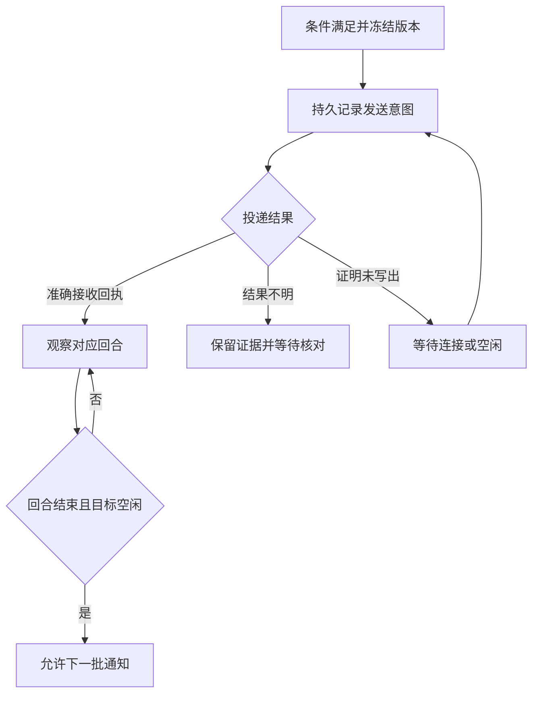

# 三项配置即可使用：设计草案

日期：2026-10-23。作者：云端 Alice。状态：三字段界面与普通通知模式为 `proposed / review_pending`，未实现、未启用；实验副本进展见下方。

最新进展：红魔已选择“未修改 Desktop＋专用新对话＋短输出/文件交付”的减量路线，按[行动方案第 8 节](KELAN_THIN_STATE_NEXT_STEPS_20261023.md#8-当前执行专用新对话减量验证)验证实际快照体量。云端已准备独立只读计量器及合成测试；Windows 观测尚未执行，G0 仍待验证。`ec2fb862` 副本候选和 `9a863af5` 清点的限定接受保留，但加载补丁、包签名/恢复和端点搜索不再是本路线的前置工作。第 10–12 节均为历史阶段，不能据旧“下一步”继续改包。

基线：`main@5c1882c7b78fc023d0588953e6e43db55ebe216d`。当前可用能力和验收边界仍以 [CURRENT_STATE](../CURRENT_STATE.md) 为准。本文件中的界面、字段和新行为均为提案，不是现有操作说明。

## 1. 要交付的体验

用户完成一次安装与环境检查后，新建规则只需选择 **文件夹、触发条件、目标对话**，检查摘要并点击“启用”。不填写 thread UUID、cwd、rollout 路径、管道参数、状态目录或业务 ACK。

| 主界面字段 | 示例 | 交互 |
| --- | --- | --- |
| 监听文件夹 | `D:\研究成果\待审查` | 本机目录选择器；显示所选目录及子目录范围。 |
| 触发条件 | 新内容就绪：Markdown，连续 2 分钟未变化 | 选择预设，在该条件内调整文件类型、稳定时间或 READY 标记。 |
| 唤醒对话 | 研究成果审查 · research-project · 当前空闲 | 本机对话列表，可按标题或项目搜索；同名时显示项目和最近活动，必要时展开短 ID。 |

下方显示一句可读摘要：“此文件夹出现新的 Markdown 内容、稳定 2 分钟后，通知‘研究成果审查’；初始已有内容不触发。”按钮为“预览条件”“启用”；预览只读检查与展示，不发送模型请求，也不提交处理基线。

“触发后做什么”作为可选展开项：默认沿用目标对话已有约定；用户可以补充“审查新增报告并总结问题”。程序不通过阅读全部聊天猜测任务。没有明确约定时，默认消息只请对话确认收到材料并询问处理目标，不能凭文件内容创造新的执行或上传授权。

**首版明确范围：Windows 上、已运行的 Codex Desktop 中、能够核验原宿主的已有对话。** 只支持当前登录用户的本地输入目录。云端 ChatGPT 窗口、跨机器唤醒、网络盘语义、自动打开或恢复未加载对话，均不属于首版承诺。找不到可用对话时展示原因和修复动作，不退回让普通用户手填内部标识。

当前选定的有限兼容方式要求专用对话从较少历史开始，并保持完整快照可在预算内读取。长报告和完整日志存为文件，聊天及工具输出只保留必要摘要；这是减少内容增长的使用约定，不是让模型控制 Desktop 的快照类型。实际预算和前后测量见当前行动方案；32 MiB 单帧上限保持。超限时保留待处理批次并停止自动投递，用户明确选择新对话后重新核验，不能自动清历史或换目标。此方式不承诺所有大型既有聊天或无限长期历史都可用，也不增加第四个必填字段。

## 2. 从首次安装到日常使用

1. 首次启动检查 Python/界面依赖、Desktop 安装与 IPC 能力、可读会话目录和可写状态位置。检查不发模型请求、不改 Desktop 数据库、不注册开机任务。缺失依赖给出具体安装说明，不能把“一次安装”写成已经实现的安装器。
2. 选择三项，生成摘要。连接检查核验准确会话、项目目录、rollout 身份与原宿主；它是只读检查，不能显示成“唤醒测试成功”。
3. 点击“启用”后完成初始基线扫描并持久保存，才显示“监听中”。默认只关注此后出现的新内容；初始化失败或中断不进入已启用状态。初始化完成前的内容属于初始基线，界面展示该边界与数量。
4. 满足条件后自动冻结版本并尝试通知。对话忙时等待；Desktop 退出、会话未加载时显示“等待连接”，输入批次仍保留。用户手动恢复原对话后，重新核验再继续。
5. 规则列表显示监听健康、待处理数量、目标状态和最近一次通知结果。支持暂停、继续、查看原因。关闭本工具会停止其监听进程；最小化继续运行。首版不隐式安装后台服务或系统托盘常驻。

首次默认“忽略已有内容”，高级项可以选择“处理当前已有内容”。此选择在启用前写入摘要。暂停/重启沿用原基线，不重新把整个目录当成新安装；恢复后补扫当前仍存在的新内容。没有运行的期间出现又消失的短暂版本无法保证捕获。

## 3. 条件的准确语义

首版提供两种预设，避免先开发通用规则语言：

| 预设 | 满足条件的含义 | 默认与限制 |
| --- | --- | --- |
| 新内容就绪 | 匹配文件出现未见过的字节版本，整个匹配集合连续稳定一段时间 | 默认所有普通文件、递归子目录、120 秒；可选 Markdown/文本/自定义 glob。 |
| READY 后内容就绪 | 相对路径下的 READY 文件存在，且匹配内容稳定并包含未见过的版本 | 默认标记 `READY`，仍等待 120 秒；标记本身不进入材料清单。 |

“新内容”沿用现有 SHA-256 历史去重：同字节改名、重复保存、恢复曾见过的旧字节都不再次触发；同路径的新字节可以触发。删除、时间戳变化、重复写 READY 不单独触发。名称必须表达这一点，不把它包装成“每次文件事件都通知”。独立的“仅新增路径”预设需要另做路径历史语义，不在首版混入。

稳定时间作用于**整个匹配集合**，不是逐个文件的独立计时器；持续变化的匹配日志会延后批次。高级设置提供 include/exclude，并复用当前 glob 匹配规则。默认排除临时文件、未完成下载和 `.git`；输出应写到输入树之外，或明确排除，避免对话生成物反复触发自己。

READY 只表示生产方宣称材料齐备。生产方必须先移除旧标记、写完材料后最后重建；本工具不自动删除或改写输入标记，不声称存在一个可跨机器证明的事务边界。

无法读取、超限、扫描中变化、ZIP 校验失败或出现不支持的链接时，该次扫描不推进基线。界面显示具体问题，已冻结批次保留。继续复用现有普通文件、大小上限、ZIP 展开/CRC 和不可变快照检查。

## 4. 如何自动找到并绑定对话

当前 `DesktopAdapter` 能针对已知 thread 调用 owner discovery、验证 cwd/rollout，并在发送前核对实时状态；**当前代码没有可供选择的会话枚举接口**。不能用“已经发现 owner”来替代“已经能列出所有对话”。

拟新增的本地 `ConversationCatalog` 只提供选择所需元数据：标题、项目路径、最近活动、稳定 thread ID、候选 rollout、来源与可用状态。来源优先采用经实际版本验证的只读会话目录接口；如需使用本机索引，必须只读、有大小/数量界限，并核对其与 rollout 的对应关系。柯蓝在当前安装观察到 `state_5.sqlite` / `threads` 及 `name`、`title` 字段；这只是该版本的私有来源证据，最终列表过滤和兼容性仍待验证，不能固定为公共 API。

选择后创建绑定：准确 thread ID + 规范化 cwd + rollout 身份 + Desktop 安装/协议能力记录。标题只作展示，不作为路由键。重名不自动猜选；改标题不换目标；项目归属或 rollout 身份不符时停止发送并要求重新选择。

绑定不是永久 `owner_verified: true` 开关。首次启用和每次发送都必须核验当前 owner、原生空闲状态、来源版本和 STOP。宿主重启后 owner 可以改变，但必须通过同一会话的身份链重新验证。安装或协议变化后重新检查能力；不静默启动独立 app-server，不覆盖模型、审批、沙箱或原生工具设置。

如果本机目录只能列出存储记录，界面可以将未加载项显示为“需要在 Desktop 中打开”，但首次启用必须完成一次原宿主核验。已启用规则后来暂时失去 owner 时进入等待连接，不作失败重发。没有可靠发现来源时，G0 不通过；不把手工 UUID 方案宣布为三项配置目标已完成。

## 5. 普通通知与严格交付分开

新建简易规则默认 `notify`。既有配置、状态目录和没有该字段的旧配置继续使用 `verified_delivery`。模式绑定到独立规则状态，不能在有历史或待处理批次的目录上直接切换。

| 模式 | 下一批何时可以发 | 用户义务 | 能证明的结果 |
| --- | --- | --- | --- |
| `notify`，普通通知 | 本批有准确接收/关联证据、对应回合已结束，再次确认目标当前空闲 | 正常情况下不用 ACK；不确定投递需核对 | 会话接收了该批通知；单独显示回合结果。 |
| `verified_delivery`，严格交付 | 沿用现有业务 ACK 与 `waiting_materials` 等规则 | 提供真实业务交付核验证据 | 已核验的业务交付，保留第一份 ACK。 |

普通通知不把 `completed`、`ended` 或“下一批可继续”写成 `delivered`，也不创建假 ACK。模型执行失败或中断保留醒目的失败结果；若准确回合确已结束且目标空闲，可以继续下一批，不自动重做失败业务。严格模式行为保持。

普通模式的判断使用三条独立事实轴，而不是一个模糊的“成功”：

| 事实轴 | 记录内容 | 对调度的影响 |
| --- | --- | --- |
| 投递 | 未发送、发送意图、已接收、结果不明；准确 batch/manifest/thread/cwd/request/turn 关联 | 结果不明阻止后续自动投递与自动重发。单纯 `queued` 不当作已开始。 |
| 回合 | 尚未确认、运行中、准确回合已结束；业务执行结果仍可为 unknown/failed | 已接收但没看到终止证据时继续观察，不靠超时或当前 idle 猜测结束。 |
| 业务 | 未核验或既有真实 ACK | 普通模式不依赖该轴推进，但不能回写成功或覆盖证据。 |

流程为：冻结批次 → 持久记录发送意图 → 重新核验目标 → 发送 → 保存准确接收回执 → 观察对应回合结束 → 等待目标空闲 → 下一批。任一步无法证明发送是否发生时，进入“需要核对”，保留原材料与意图。



重启时先核对既有意图与宿主证据；不能以“历史暂时找不到”证明未发送。已有精确文本匹配可用于保守关联，但继承其来源不认证、人工复制可能混淆的限制；模糊/多条匹配不能解锁。首版简易模式要求准确 native turn 回执或经过审查的等价关联证据。

“需要核对”界面提供证据查看和暂停，不提供把未知变成已交付的一键按钮。人工恢复必须另行记录依据和选择；尚未定义可证明未发送的恢复路径时，可以继续保持暂停，不无限自动重试。

目标忙时仍可冻结新的稳定批次，按形成顺序处理，不改写旧 manifest、不静默丢弃中间已冻结版本。首版每个目标会话最多启用一条受本工具管理的规则，并使用按会话的进程锁防止本工具多个实例同时投递。这个锁不约束用户或其他客户端；现有 IPC 缺少原子 idle-and-start，人工输入与发送之间的残余竞态仍须如实提示和验证。

## 6. 界面状态与运行边界

| 对外状态 | 含义与下一步 |
| --- | --- |
| 监听中／等待稳定 | 条件尚未满足，不发模型请求。 |
| 等待对话空闲 | 批次已保存，等原对话空闲；不抢占、取消或插入当前回合。 |
| 等待连接 | Desktop 未运行或原对话未加载；显示“在 Desktop 中打开该对话”。 |
| 会话已接收／正在处理 | 有准确回执或开始证据；不显示“业务完成”。 |
| 本轮已结束 | 显示执行结果和后续批次；unknown 不能显示为成功。 |
| 需要核对 | 投递不确定、绑定冲突或证据缺失；显示具体原因，不盲重发。 |
| 已暂停／已到期／资源上限 | 停止新的投递；说明哪些扫描或冻结工作也已停止。 |

状态由监听健康、连接、批次进展分别组成，避免“已送达”遮住监听进程已退出。状态页展示最后实际扫描时间和退出原因，不把进程存在当作健康证据。

暂停或关闭立即阻止本工具新的发送并保留积压；已经被宿主接受的工作要到宿主中停止。恢复不能清除旧试验的到期限制。更换输入目录、目标对话或模式时新建规则状态；编辑条件时暂停并保存新修订，已经冻结的批次保留旧条件及目标，不偷偷改投。

新规则不自动绑定旧生产状态，也不继承“生产已经授权”的假设。设计不解除当前旧试验 STOP/到期锁，不恢复 PAUSED 云端任务。上传/Drive/Hub、自动业务 ACK、强制窗口导航和关窗都不进入简易模式的默认路径。

资源边界作为高级设置而非第四项必填：提议默认最多 100 个尚未结束的冻结批次、每条规则 1 GiB 状态总量；沿用现有单文件 100 MiB 和 ZIP 展开 200 MiB 上限。积压达到 100 批时暂停新增冻结，已有批次仍按正常证据条件推进，以便积压下降；达到状态总容量或无法可靠写入时，暂停新增冻结与自动投递。保留证据并显示处理方式，不自动删历史。恢复补扫当前版本，不能承诺补回未保存的中间版本。这组容量默认值待合成积压测试验证后定稿。

## 7. 实现边界与数据兼容

首选用 Python/Tkinter 做轻量本机表单，复用现有 Python 运行环境；先核验目标环境是否具备 Tk。界面不需要新的远端账号或 HTTP 服务。首版不建设浏览器控制、通用工作流编辑器、托盘、安装包升级器或云控制台。

| 组件 | 责任 | 可复用内容与必要新增 |
| --- | --- | --- |
| 本机表单 | 三项选择、摘要、启用/暂停、状态展示 | 新增薄界面；不把规则语义放在控件回调里。 |
| Rule service / config compiler | 验证用户规则、生成稳定 rule ID、私有运行配置和进程管理 | 新增 schema/version、规则修订、按会话互斥；保留现有 CLI。 |
| ConversationCatalog / binding | 元数据发现、绑定与每次能力复核 | 新增枚举；复用 `desktop_ipc.py` 的安装、owner、native/rollout 核验。 |
| 扫描与批次 | 条件、基线、去重、冻结版本 | 复用 `trigger.py`；新增“初始忽略”基线记录与资源限制。 |
| 调度与状态投影 | 模式选择、通知证据、下一批资格、可读状态 | 修改选择策略，保留先持久化再外发、不确定不重发和 ACK 不可覆盖。 |

用户规则与机器解析配置分开保存。以下是**拟议的语义示例，不是可直接交给当前 CLI 的配置**：

```json
{
  "schema_version": 2,
  "input": {"directory": "D:/research/inbox"},
  "condition": {
    "preset": "new_content_stable",
    "include": ["*.md"],
    "settle_seconds": 120
  },
  "target": {"selection_ref": "local-catalog-selection"}
}
```

`selection_ref` 由选项返回，不能凭显示标题解析或重用为另一个目标。高级默认项 `dispatch_mode=notify`、`initial_files=ignore`、排除项、容量限制由编译器显式落盘。实际绑定保存准确 ID/cwd/rollout 和能力核验来源；本机 owner ID 只是需复核的缓存。私有目录建议放在当前用户应用数据目录的 `rules/<rule-id>/`，自动与输入树校验为互不嵌套；输入若覆盖默认状态目录，拒绝该组合并说明原因，不能偷偷把状态写进监听树。

数据改动以实现时的最小迁移为准，但必须满足这些契约：

- 初始忽略内容进入独立的 `baseline_versions`（或等价记录），原因明确为 `initial_ignore`。不能调用 `seed` 假造已交付批次；实际批次与初始基线共同参与内容去重。基线完整保存后才标记初始化完成，崩溃不得留下半份已启用基线。
- 规则修订与模式写入状态绑定；每个批次记录创建它的规则修订，不靠可变配置解释旧证据。界面预览不得提交 baseline、versions 或 batches。
- 普通通知新增结构化的接收和终止证据记录（可用以 batch ID 为键的辅助表），保存准确目标、请求、turn、manifest 哈希和来源。现有业务 `delivered`/ACK 记录不改义；“允许下一批”由证据推导，不用手工改旧 state 绕过。
- 通知证据与已有批次状态更新在同一事务中保持一致；接收回执落盘前崩溃仍按 uncertain 处理。严格模式的第一份 ACK、并发防覆盖与原 material-wait 语义保持。
- 缺少新字段的旧配置解析为 `verified_delivery`。初始忽略默认只适用于新简易规则，不能自动给旧库补 baseline。旧环境升级先在副本上验证；拒绝旧版本程序写入它不认识的新 schema，回退用保存的旧配置/状态，不能删新列假装迁移不存在。
- `native_result_collection`、owner loading 和上传选项不被界面悄悄打开。普通通知所需的准确终止观察与执行成功采集分开，缺证据保持待核对。

## 8. 分阶段验证与停止点

当前为三字段设计、已接受的隔离补丁候选及新准备的只读快照计量器；三字段界面/调度未实现，当前路线尚无新实机结果。按[专用对话执行范围](KELAN_THIN_STATE_NEXT_STEPS_20261023.md#8-当前执行专用新对话减量验证)先验证减量效果；初始化和一次样例任务单独记录模型调用，G0 的目录/状态查询本身不发送模型任务。通过后按下表推进。

| 阶段 | 最小交付 | 通过依据／停止条件 |
| --- | --- | --- |
| G0：发现与绑定 | 在真实目标 Windows Desktop 版本只读列出候选，完成选择到原宿主及有界当前状态的核验；核对 Tk 可用性 | 记录版本、来源、同名区分、cwd/rollout/owner/当前状态一致及读取预算；查询流程模型调用 0。当前接受验证完整快照的有限兼容方式，不以摘要补丁加载为前提；目录、归属、预算或当前状态缺证据时不进入 G1/G2。 |
| G1：规则与调度 | 合成目录 + fake adapter 实现三项规则编译、初始基线、notify/strict 两模式与恢复 | 下列验收矩阵通过；旧配置及 ACK 副本对比通过。只运行受影响测试及必要回归。 |
| G2：最薄界面 | 三项表单、摘要、预览、启用/暂停、状态展示；新用户完成一条规则 | 不编辑 JSON/UUID；首次环境通过后，已知目标与条件时以 2 分钟内完成配置为可用性目标，记录实测，不当作已达标。 |
| G3：有界真实试用 | 在隔离规则与合成目录中，连续两个不同稳定批次通知同一原会话 | 真实版本/准确绑定、两条接收和回合证据；不用业务 ACK 也能继续；无重复发送；退出和 STOP 有证据。实际运行范围由该次授权确定。 |

实施验收矩阵：

| 情境 | 必须观察到的结果 |
| --- | --- |
| 初始目录已有文件；预览多次；启用 | 预览 0 模型调用、0 基线推进；默认已有内容不触发；初始化中断不留下 enabled。 |
| 一个文件分多次写入；多个重复事件 | 稳定窗口重计；一次稳定新内容只形成一个批次。 |
| 同字节改名、重复保存、删除、恢复旧字节 | 不生成新模型任务；同路径新字节按规则产生新批次。 |
| READY 缺失/重建；过滤文件持续写入 | 标记缺失不触发；满足新内容与稳定条件才触发；未匹配文件不阻碍稳定。 |
| A 被准确接收并结束，B 随后就绪 | notify 在目标空闲后发 B，不要求 ACK；A 不被标为业务 delivered。 |
| A 回合失败/中断/结果 unknown | 分开显示结果；仅在准确终止和空闲均成立时继续，不自动重做 A。 |
| 仅 queued、只有 idle、回合结束证据缺失 | 不把它们单独当作可以继续的证明；目标关联不丢失。 |
| 发送前断线、发送后回执丢失、接收后落盘前崩溃 | 只有证明没写出才能重试；其他情况恢复为 uncertain 并先核对，不重复外发。 |
| 对话忙、owner 消失/变更、重名、标题改变、项目不符 | 等待或重新核验准确目标；不改投、不强制恢复、不用标题推断绑定。 |
| 两个本工具实例、人工并发输入 | 本工具按会话互斥；最终重查忙碌/STOP；如实记录原生非原子竞态，不宣称通用并发保证。 |
| 扫描失败、资源上限、退出、暂停、重启 | 已冻结版本/证据不丢；状态真实；补扫范围与缺失瞬时版本限制可解释。 |
| 旧 strict 配置/数据库及并发 ACK | 原 ACK、binding、截止时间与 material-wait 保持；不自动切模式、不清除到期锁。 |

主要未知为 **目录最终过滤、原 Desktop 服务可访问的有界当前状态入口、实际版本兼容性，以及 native idle/start 竞态**。公开脱敏材料现已回读；私人原件及实际安装代码仍由柯蓝保留，未由 Alice 独立重跑。目录初查提供可行性线索，尚不等于最终用户列表或准确发送能力通过。没有足够证据时缩小能力说明，不用手工配置或 fake adapter 的成功替代真实验收。

## 9. 需求来源、判断与接续

用户在本项目当前对话提出“只需要指定文件夹，指定触发的条件，指定触发后唤醒的对话就可以使用”，随后明确“嗯可以，开始设计吧”。这授权了本轮设计与既有项目文档记录；不等于已经接受上述所有具体默认值，也不延续旧 PR 的合并、安装或生产激活授权。无可用稳定消息链接，保留可识别短引文，不编造消息 ID。

设计判断：复用已有文件核心和原宿主核验，新增薄配置层及独立 notify 推进策略，比重写通用自动化平台更符合当前目标。参考比较已见 [既有设计与固定来源](DESIGN_AND_REFERENCES.md)；本轮不重新声称某竞品没有此能力。预期增益是省去手工标识与逐批 ACK；真实配置耗时、维护成本和用户收益尚待 G2/G3 观察。

实际阅读依据：基线 `AGENTS.md`、`CURRENT_STATE.md`、中文 README、最近 WORK_LOG、配置示例、集成/IPC 文档、`trigger.py`、`chat_adapters.py`、`desktop_ipc.py`。其中 `load_config`/`Store`/`dispatch_one` 支持当前手工字段、绑定、ACK 阻塞与持久意图结论；`snapshot`/`StableScanner`/`Store.plan` 支持稳定、内容去重与冻结语义；IPC 的 `owner`/`current_state`/`send` 支持原宿主核验与非原子发送限制。源码来源固定于上述基线，文档中新的模块名/字段仅为设计接口。

本轮由云端 Alice 承担设计、仓库文档和自审，Class C / enhanced；审查独立性为 S0，不声称获得柯蓝独立意见或真实 Windows 证据。未派发其他 agent。设计阶段的预算边界是完成这份可评审方案和文档核对，不进行安装、运行实验或追加市场调研。

初稿发布后，红魔转交了柯蓝的本机 G0 初查，实际接续见第 10 节。三项体验、notify 推进语义和旧配置兼容的设计继续保留；本轮没有直接向本地窗口派发任务。方案可通过后续文档提交修订或撤回，不影响当前运行代码、历史账本和旧试验停止状态。

## 10. G0 初查接收与有界状态查询接续（历史阶段）

本节记载 `4dd30721` 时的判断；其中“待补交/未回读”是当时状态，已由第 11 节更新，不应重复派发已完成事项。

**来源与结论。** 2026-10-23 红魔在本项目对话转交柯蓝对初稿 `845ad38ef6d169435dade90163e102cc48dd2e13` 的本机检查摘要。该摘要是当前本机结果来源；`KELAN_PR2_G0_INTAKE_20261023.md`、`IPC_FRAME_DIAGNOSTIC.json` 仍仅在本地，Alice 未读取原件，也未核验其长度、哈希、实际安装版本或执行命令。因此接受其作为调整设计顺序的输入，不签署 G0 通过或独立实机验收。

| 转交的观察 | 当前可以采用的判断 |
| --- | --- |
| 181 条本项目未归档记录、2 组重名；目录与 rollout 首行可对应 | 会话发现有可行性线索；还需最终过滤、同名区分和准确来源证据。 |
| 出现 Windows 扩展路径；`name` 与原始 `title` 不同 | 列表展示和身份比较需按实机格式设计，不能只做字符串全等或用标题路由。 |
| 原成果聊天没有找到可用 owner | 显示等待连接/未核验，不能推断可发送。 |
| 已加载维护聊天有 owner，读取状态时帧头声明 34,956,277 字节，超出 32 MiB，未读正文 | 该次状态观察失败；“找到 owner”不能替代“当前可发送”。帧类型、来源归属和具体内容仍未知。 |
| tkinter 可导入、Tcl 初始化成功，未打开 GUI | 依赖初查有进展，不能宣称界面或目录选择器已验证。 |

**Alice 直接核对的源码事实。** 固定输入的 [desktop_ipc.py](../desktop_ipc.py) 中，`MAX_FRAME = 32 * 1024 * 1024`，即 33,554,432 字节；报告长度超出 1,401,845 字节。`read_frame` 先读 4 字节长度，越界便拒绝，正文解析及 request/method/owner 过滤都在之后。故即使发生于状态查询过程，也不能仅凭帧头认定是完整历史响应、目标快照或某个无关广播。

`current_state` 的已知路径是 follow → load-complete-history → 再请求 snapshot → 验证 revision/owner/thread/cwd/resumed/runtime → 返回小投影。**返回值小不代表接收数据小**；在本机摘取几个字段仍可能先传输、解析完整快照。转交结果与此路径的体量风险一致，但超限帧的具体因果仍待实机来源核对。现有 [原生状态测试](../tests/test_native_state.py) 覆盖小型替身的绑定和新鲜度语义，不能证明长历史会话上的成本上界；本轮仅阅读，没有重跑这些测试。

**对原设计的最小补充。**

- 列表先从目录读取必要元数据，不对 181 条记录逐一订阅完整状态。只对当前选择或明确重试的目标做实时核验；未查过的项显示“未核验”，不显示“离线”。
- 展示名优先非空的用户 `name`，其次原始 `title`，再用无标题占位；路由仍用稳定 thread ID 与项目绑定。目录字段和优先级须用原件确认，未知格式不猜测。
- Windows 本地驱动器的普通路径与扩展形式须经实际 Windows 路径语义核对；保留原始路径作 I/O 与诊断，统一身份比较入口。不能通过无差别删除前缀把 UNC、设备路径或不同目录误合并；首版仍不扩大到网络盘。以两种等价本地写法和一个不同目录的负例作最小验证。
- 新增“宿主可达，但当前状态读取受阻”的明确原因，保留 `unknown`。不能用 owner 存在、目录更新时间、进程存在、rollout 暂无新增或历史完成记录推定当前 idle。

**下一次最小验证建议。** 接收者为本项目真实本地柯蓝，角色为协议可行性验证者；Alice 为云端设计作者和后续证据审阅者。红魔转交的摘要证明初查已经发生，不自动授权安装、正式修改 Desktop 或扩大试验。以下是原 G0 的候选接续，须由本地当前有效任务授权覆盖；本轮仅保存方案，没有调用 AI 通信或声称本地已接单。

1. 先向原 PR #2 补交上述两份材料的可公开版本，保留安装版本、代码 pin、命令、阶段、声明长度、实际读取字节和异常类别。私有标题、会话正文、完整目录数据库、凭据不进入公开仓库；原件留本地并给出摘要/哈希。无需为补材料重跑已经发生的失败。
2. 静态核对**实际已安装版本**的协议声明与处理路径，确认是否有不载入完整历史的状态读取方式、字段投影或等价的新鲜度证明。核对订阅本身会不会推送完整快照；仅删除 complete-history 调用不自动证明轻量或等价。不得臆造方法名，也不把独立 app-server 的状态当作原 Desktop 状态。
3. 只有发现有依据的候选路径后，做一个有界只读探针：优先使用已加载维护聊天作正例，原成果聊天不可达作负例。事先固定单帧、累计接收字节和耗时预算，沿用不扩大现有 32 MiB 接收上限的边界；记录实测字节与耗时。超限、归属不明或无候选就停止并报告，不用重试刷新截止时间。不得启动模型、强制打开窗口或为测试制造新业务。
4. 通过条件同时包括：准确原宿主/目标绑定；可关联本次观察的新鲜度依据；区分 resumed、idle、busy、unknown；全过程接收与处理成本受已声明预算约束。接收完整大历史后只输出小 JSON 不算达到轻量目标。忙碌、旧 revision、错误 owner/cwd 的已有替身语义也必须保留；不为捕获 busy 主动发模型任务。

原帧上限继续保留。提高到 64 MiB 可能让这一特定长度不再被拒，但不能单凭此关闭持续增长的历史成本问题；本轮不将调大上限作为修复。若已安装版本确无轻量方式，交回证据和一个有明确成本的有界替代方案，再选择适配路线；不要先实现 G1/G2 来掩盖 G0 缺口。

轻量状态路径通过也不取消既有 64 MiB rollout 观察上限或原生 idle/start 竞态；本轮只解决已观察到的状态读取阻点，不顺带重写全部历史读取。已有短会话成功证据和本次长会话失败可以同时成立，均不能互相冒充适用范围。

本轮范围仍为 Class C / enhanced 的设计修订，Alice 同上下文自审 S0。原件补交、候选探针及真实 G0 通过均待后续；新代码、界面、调度、生产恢复和合并均未发生。该接续范围在 G0 结论形成、协议/目标改变或收到 STOP 时结束或重新核对。


## 11. 补交材料审阅与原宿主入口取舍（历史阶段）

本节保留 `95c6519d` 的历史审阅和任务范围。第 11.3 节调查已在 `e83da55` 完成，未找到已检查通道中的现成入口；其“下一轮”不再是当前待办。现行接续见第 12 节。

**审阅结论：接受本轮调查作为 G0 受阻的证据；继续保留三项配置方向。** Alice 已完成对柯蓝固定提交 [9116c888](https://github.com/scarlet-devil/codex-condition-trigger/commit/9116c88881d5fb1d04270de3fd63fc34aefe6bf6) 的公开材料审阅。此轮证据审阅完成，不等于 G0 通过、PR 可合并或已有三项表单；整体仍为 Draft / review_pending。当前实际阻点是外部触发器如何准确连接原 Desktop 使用的服务并读取实时状态。

### 11.1 已核对的证据与限制

- 10 个变更文件均从固定提交完整读取并核对 Git blob；[清单](https://github.com/scarlet-devil/codex-condition-trigger/blob/9116c88881d5fb1d04270de3fd63fc34aefe6bf6/evidence/kelan-light-state-manifest-20261023.json)的 9 项长度、SHA-256 和 blob 全部一致，清单本身不列自身。它描述该历史提交的字节，不能用来验证后来已更新的 CURRENT_STATE 或 WORK_LOG。
- Alice 另读设计、AGENTS、IPC 运行源码和相邻测试，共核对 14 个 blob。探针锁定的本地依赖哈希与公开 desktop_ipc.py 的 CRLF 形式一致；公开 LF 文件 SHA-256 为 `6ea5657e827861ac2831825a6e65b93ca53ecff0e0a6b4c43fe6b1745051af9b`，CRLF 为 `f11a41f9ad395a7c721fecbed006299b8be610bdfd271b6611d5d068605c150f`，未将换行差异误判成逻辑变更。
- 探针 Python AST 解析通过；直接审阅确认其发送白名单、读取正文前的长度检查、累计预算和共享截止。两份实测逐帧长度加帧头分别等于 2,059 / 1,245 B；`can_send=false`、`runtime_status=unknown` 与报告一致。
- [安装源码调查](KELAN_LIGHT_STATE_FOLLOWUP_20261023.md)与[索引](../evidence/kelan-light-state-static-index-20261023.json)仍归属柯蓝；公开包未包含完整安装代码，Alice 没有独立实测 Windows 或复现这次安装扫描。七项合成检查和 Ruff 为柯蓝报告的结果；公开预检文件只含计数摘要，不能宣称 Alice 已独立复跑。
- 设置接口返回的 `resumed` 不证明 `idle`，原目标的 `owner_unavailable` 也不是触发器失败后应自动重开窗口的依据。此前 34,956,277 B 被拒帧的具体归属仍未知。

### 11.2 查询契约按实际协议定义

Alice 于 2026-10-23 读取[官方 App Server 文档](https://learn.chatgpt.com/docs/app-server)：`thread/read(includeTurns=false)` 返回摘要和运行状态，不因读取而 resume/订阅；文档列出 stdio、WebSocket、Unix socket 等传输。这说明存在候选接口，**不证明当前 Windows Desktop 已暴露可连接入口，也不证明安装版与在线文档完全相同**。应核对实际安装版本的 schema、处理代码和连接方式。

候选轻量路线仍须证明原服务身份、准确 thread/cwd、响应与本次请求对应、状态来自该服务当时的运行状态。不要硬编码“所有协议必须有名为 revision 的字段”：

- 现有 snapshot 适配器继续保留 revision 验证；本轮不更改其运行契约。
- 若实际轻量协议没有 revision，可研究“已核验的原服务连接 + 唯一请求 ID + 共享截止内响应 + 原生运行状态 + 精确目标/cwd”的等价观察依据。先核对服务端读取语义，不能只凭请求 ID 排除返回缓存旧值；有 revision 时仍检查它。
- 只有当前原服务的 `idle` 才能作为空闲证据；`active` 表示等待，`notLoaded` 表示未加载，`systemError`、缺失、错目标/目录/服务、超时或失效响应均不放行。临时另起服务返回的状态不代表原宿主。
- 发送前仍须重查；此方案不提供原子 idle-and-start，也不替代准确回合终止或业务 ACK。新路径的错响应/错服务/错目录/过期观察拒绝用例须在实际适配时验证。

### 11.3 只再调查一个入口问题

**下一轮建议为一次最多 60 分钟的只读入口调查，交付即停止，不进入表单和调度实现。** 这是一项待本地接续的具体范围，本次没有向柯蓝发送任务或声称他已接单。

1. 沿已定位的 `readThread → requestClient` 追到连接工厂、原服务启动参数和现有端点来源。仅查看相关安装文件及必要进程/端点元数据；记录安装哈希、调用链位置、协议类型、服务与 Desktop/owner 的对应证据。只输出必要脱敏字段，不收集完整环境、凭据或会话正文。
2. 先回答原服务是否已有允许外部客户端读取的入口。若只有私有 stdio、未暴露转发、要求修改安装包/进程注入/重启改启动参数，或在范围内找不到确切入口，就交回“本轮未找到可复用入口”的证据和限制。不要猜端口、抢读既有 stdio、启动替代 app-server，或将“本轮未找到”扩大成“产品绝不存在”。
3. 只有现有入口、原服务绑定及只读处理路径均有依据，才对此前两个固定目标各尝试一次。已加载维护聊天作为正向状态样本，原成果聊天未加载则作为负例；不为试验打开窗口或制造 busy。允许既有握手/身份发现以及有证据的 `thread/read(includeTurns=false)`，不调用 resume、follow、完整历史或 turn/start。
4. 沿用 64 KiB 单消息、每目标 1 MiB 累计接收和初始化至最终响应共享 10 秒截止、重试 0；若协议的计量单位不同，明确应用层消息/帧和额外开销的边界，所有无关通知照计。连接、身份核验及安装读取另列预算与耗时，不能把 RPC 截止写成端到端硬保证。接收侧可观测的字节与解析成本，不冒充服务端总 CPU/内存上界。超限或归属不明立即停。
5. 交回一张入口结论表、最小脱敏探针及字段/身份匹配证据、预算与结果。如发现入口，先接受这一子项，再补齐目录最终过滤和 Tk GUI 验证后判定 G0；原目标继续不可达时保持等待连接，不为它强开窗口。

安装核验每次哈希约 626 MB 是另一项已观察到的成本。后续性能设计应把环境核验与逐目标状态查询分开，并验证安装变化后的失效策略；当前两次亚秒观察不能直接承诺高频轮询成本。本轮不提前实现缓存。

若该入口调查仍失败，就结束这条接续并做产品取舍：保留已合并的有限实验接入，或另行比较“本工具管理自己的会话/服务”等方案的成本。后者会改变“唤醒已有 Desktop 对话”的要求，应先向红魔说明区别，不能悄悄替换。三项配置仍是界面目标，不应靠放宽状态证明来完成。

本节由云端 Alice 审阅、设计修订并 S0 自查。未运行真实 IPC、模型、窗口或安装操作；未改变当前持续运行、历史 STOP/到期/PAUSED、业务账本或 ACK，也未把历史试验停止状态写成当前监听健康结论。新方案保持 Draft，实际实现与启用另按后续任务范围推进。


## 12. 三项讨论落地与最小补丁接续（历史阶段）

2026-10-23，红魔讨论专用触发对话、小探针/繁忙延迟及快照接口修改后，要求记录 WORK_LOG 和柯蓝下一步方案。Alice 接受 e83da55 的公开调查作为限定证据：5 个增量文件及 2 个相关文档匹配 Git blob，清单 4 项一致；没有复现 Windows 观测，也没有据此放行 G0。详见[当前接续方案](KELAN_THIN_STATE_NEXT_STEPS_20261023.md)。

三项决定为：首轮绑定用户指定的专用对话，按准确线程身份投递同对话新回合；日常用只读状态查询处理忙闲，真实小消息仅作有界验收；优先在现有 IPC 增加独立摘要查询，保留原完整快照。材料路径可减小模型输入，不能替代 Desktop 的状态返回协议。被拒大帧只有长度证据，具体内容与归属仍未知。

本阶段当时要求交付补丁候选、最小调用端与隔离检查，以及加载/完整性/回退方案；副本交付现已完成，后续加载范围以行动方案第 6 节为准。复用已定位的 owner 检查、原连接与内部摘要读取，先确认实际需要改动的位置；不保证“只改一字段”，也不预设必须大规模重构。安装副本上的逻辑通过不等于原宿主状态已经可读。实际安装替换/重启须基于具体候选确定范围，不由本次文档发布自动发生。

`isSteering:false` 保留；现有 busy 测试只证明发送前拦截，未证明宿主原子 busy 拒绝。候选“直接试发、忙则延后”须先证明没有接收、入队或 steering，才可把明确拒绝当作重试依据；不确定投递仍先核对。摘要查询本身不能消除 idle/start 竞态。

G0 还需原服务有界查询的实测、目录最终过滤及 Tk 界面验证；随后再按 G1/G2/G3 推进。三项讨论形成了下一步路径，不等于三个问题已经修复。此轮只修订文档，未派发任务、修改运行安装或生产状态；新方案与整体 PR 继续 Draft / review_pending。
